<a href="https://github.com/maryamansarii1647?tab=repositories">
  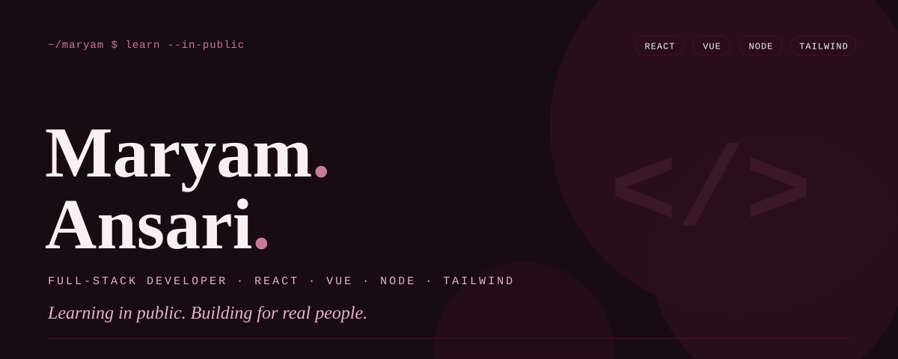
</a>

  
  
  <!-- Have LinkedIn? Uncomment and replace the handle:
  
  -->
  

Hi, I'm **Maryam Ansari** — a full-stack developer in the making, learning in public.
I build interfaces with **React, Vue and Tailwind CSS**, and server-side apps with
**Node.js** — and I'm currently levelling up on the backend with **PHP and MySQL**.
My flagship build so far is **DyslexiaHub**, a learning website designed for dyslexic readers.
*Open to internships and collaborations — say hi.*

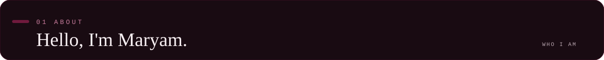
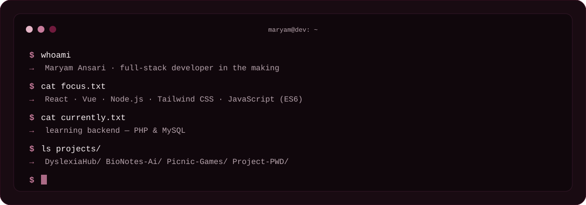

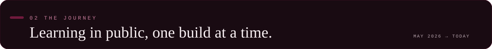
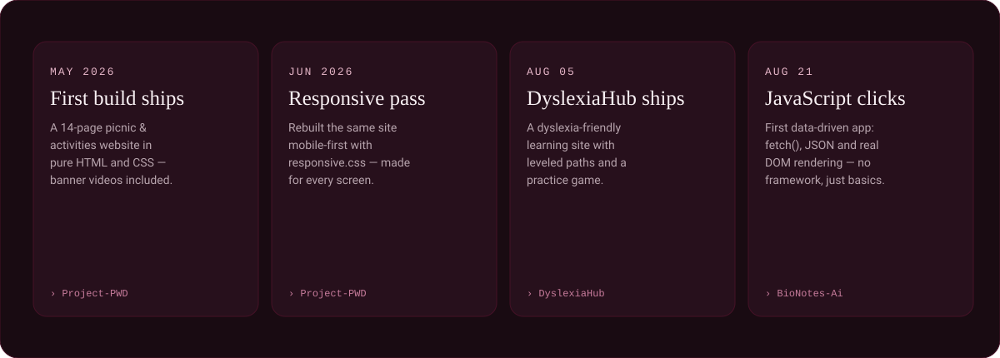

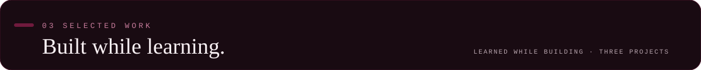

<a href="https://github.com/maryamansarii1647/DyslexiaHub">
  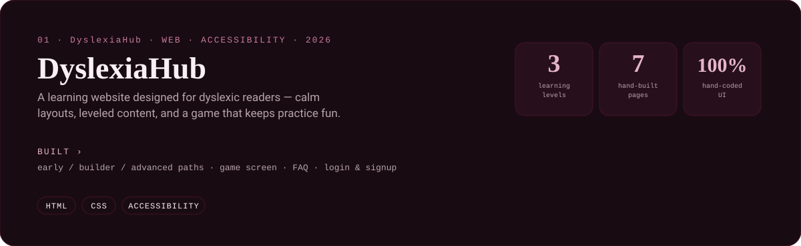
</a>

  

<a href="https://github.com/maryamansarii1647/Picnic-Games">
  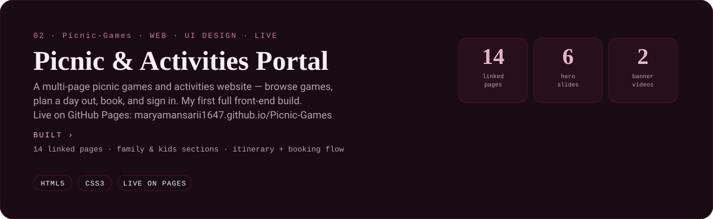
</a>

  

<a href="https://github.com/maryamansarii1647/BioNotes-Ai">
  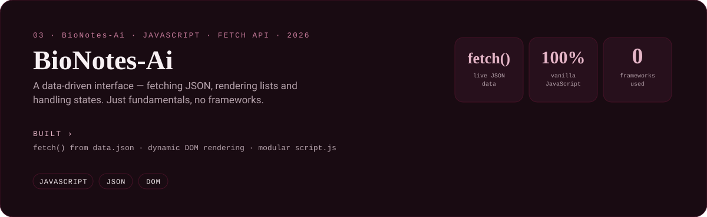
</a>

  

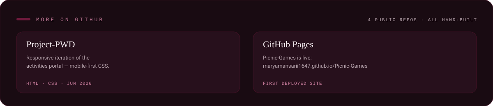

  <h6 font-size="9px"><b>More on GitHub —</b></h6>
  
  

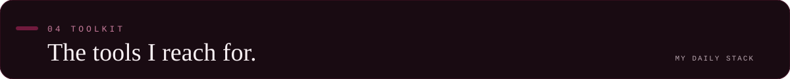
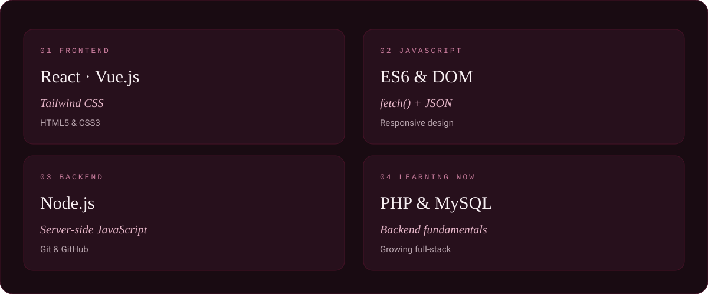

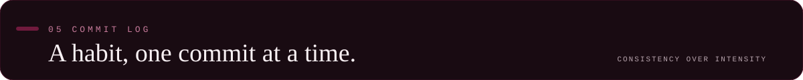
<!-- The snake appears after the GitHub Action runs once. -->
<!-- 

  

 -->

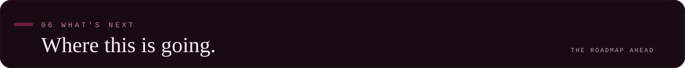
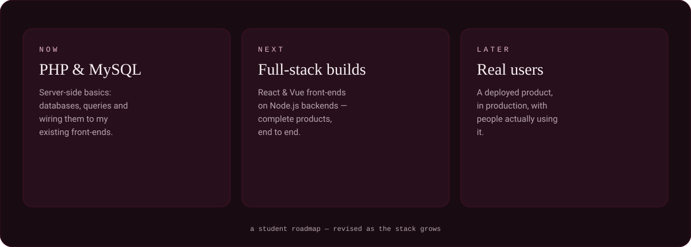

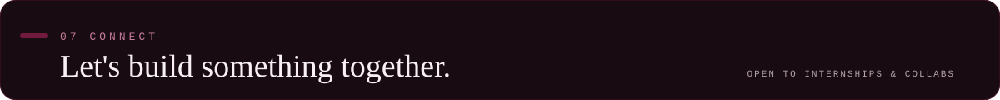

  
  <!-- Have LinkedIn? Uncomment and replace the handle:
  
  -->
  
  

<a href="https://github.com/maryamansarii1647">
  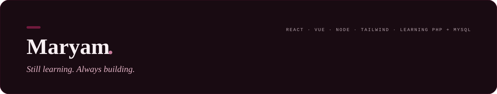
</a>
